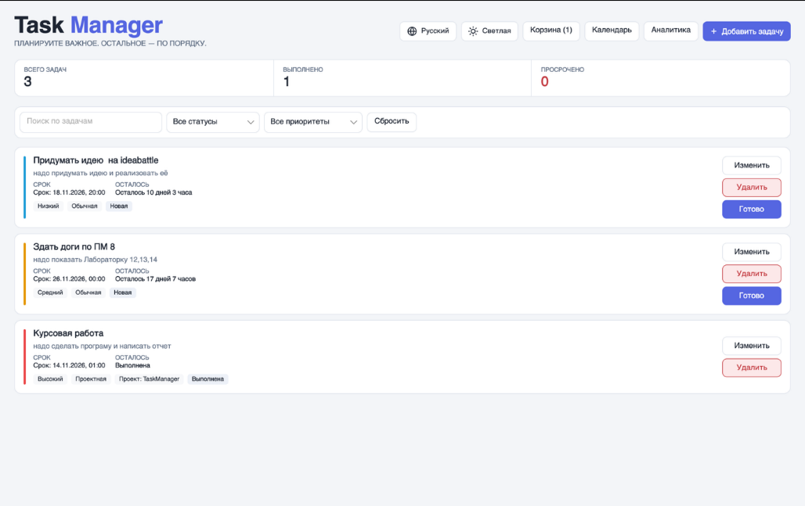
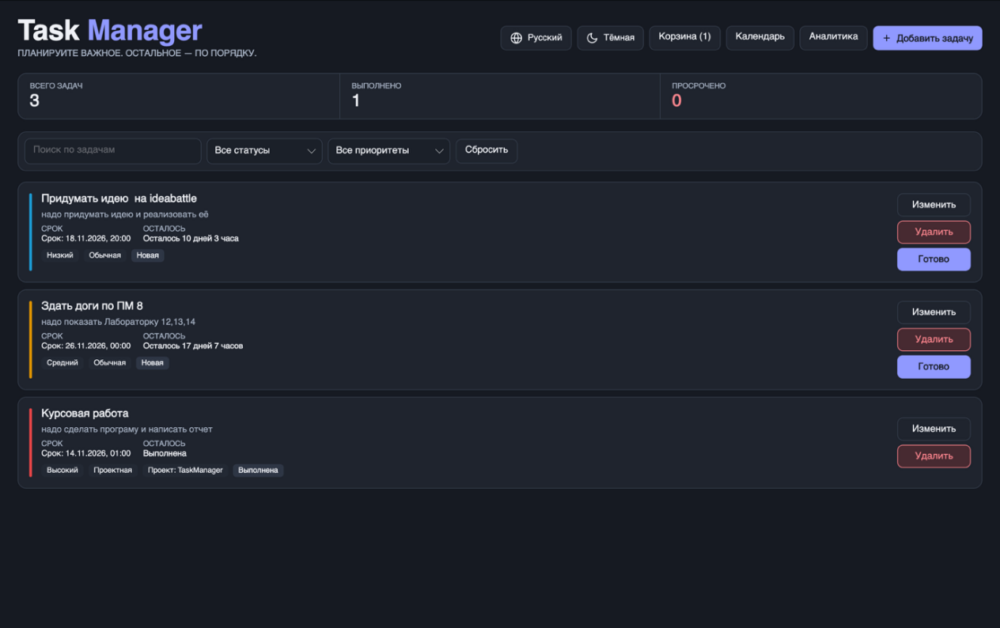
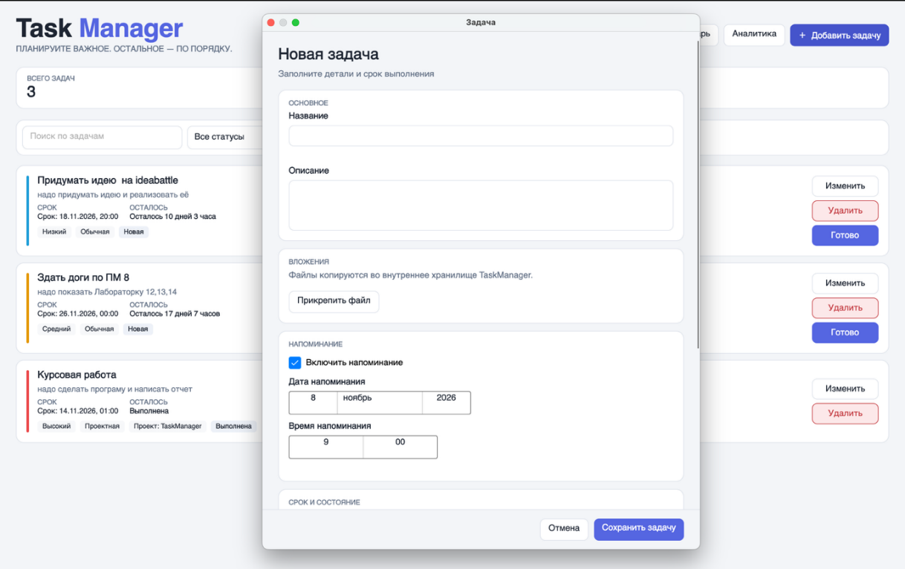
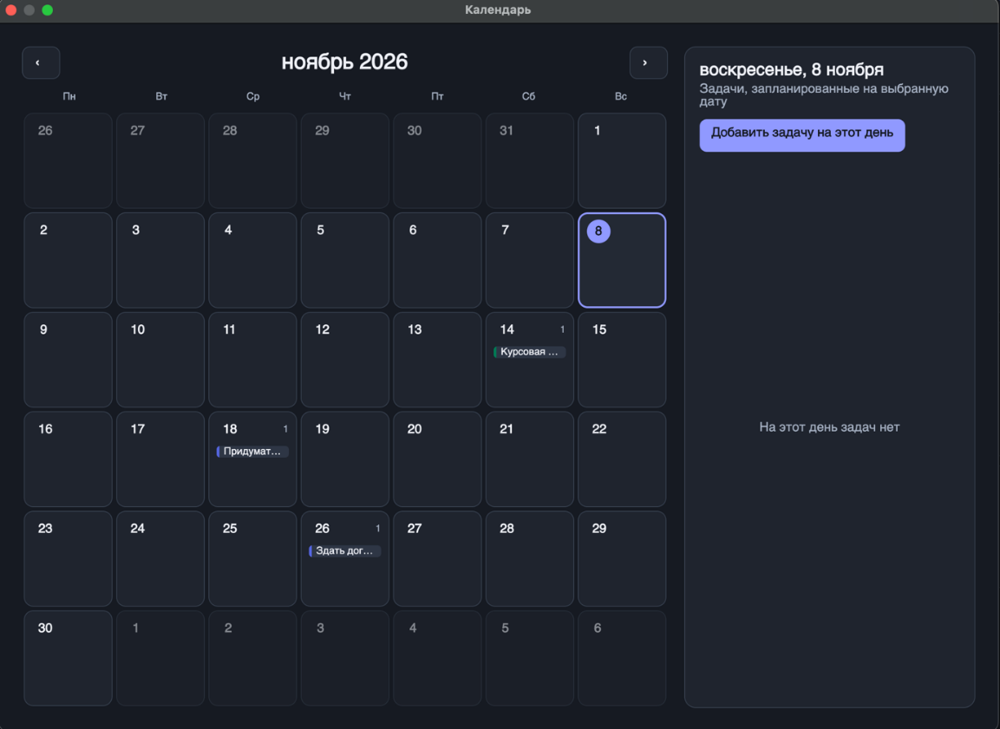
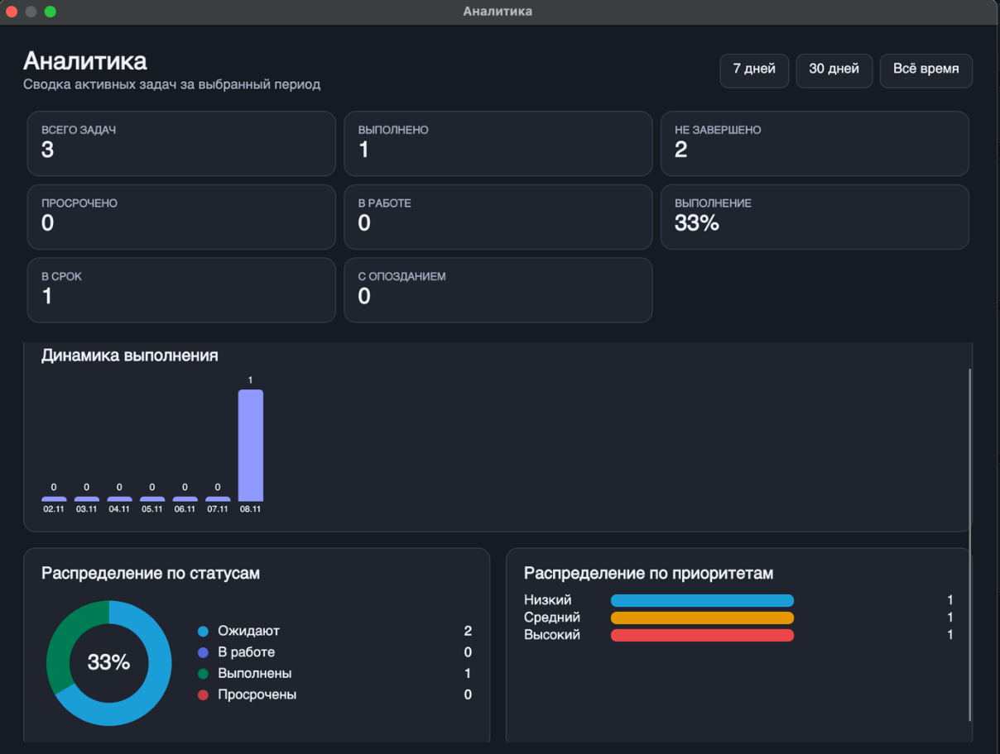
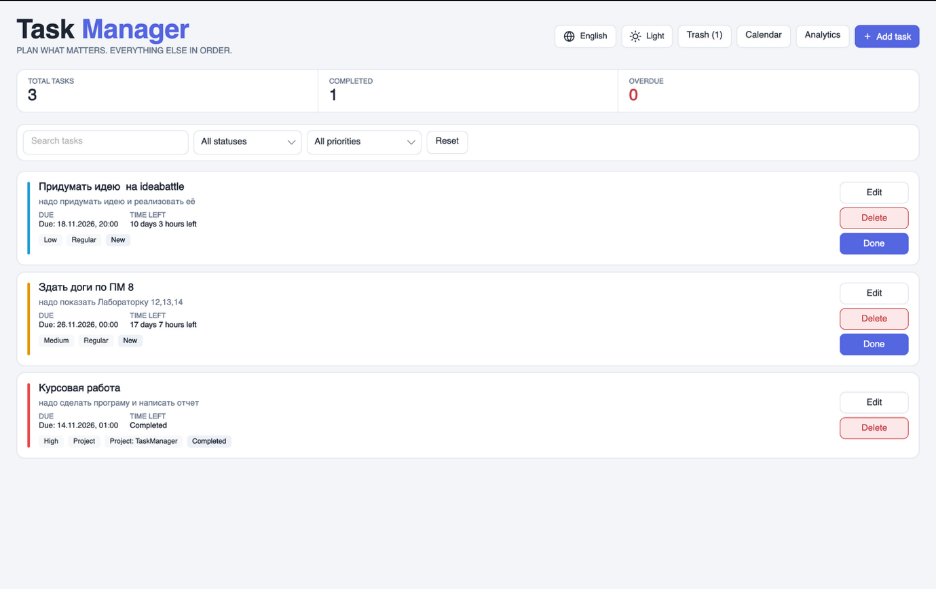
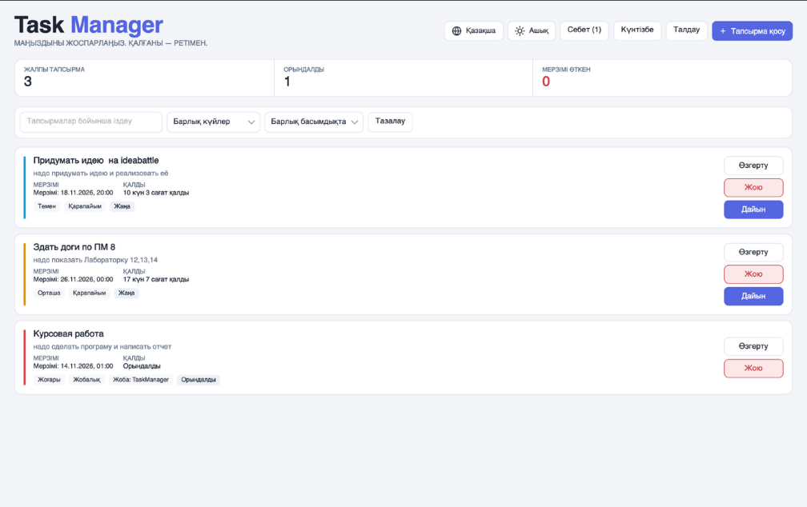

# TaskManager

**Менеджер задач и сроков выполнения для macOS.** Работает локально: без регистрации, без интернета, все данные хранятся у вас на компьютере в понятном JSON-файле.


<p align="center">
  
  
</p>

## О проекте

TaskManager начинался как **учебная курсовая работа по объектно-ориентированному программированию на C#**. Тема звучала так: «Программа управления списком задач и сроками выполнения». Задача была не просто написать «список дел», а на реальном приложении применить основные идеи ООП (инкапсуляцию, наследование, полиморфизм), разделение программы на слои, работу с файлами и обработку ошибок.

В процессе работы проект вырос из учебного примера в законченное приложение:

- нужен был компактный менеджер дел, который **не требует регистрации и сети** и не перегружен функциями;
- программа должна **понимать сроки**: подсказывать, что просрочено и сколько времени осталось;
- данные не должны теряться: при сбое или повреждении файла приложение **восстанавливает список из резервной копии**;
- разработка шла на MacBook с процессором Apple Silicon, поэтому вместо Windows-технологий (Windows Forms, WPF) выбрана кроссплатформенная библиотека **Avalonia UI**.

## Возможности

**Задачи**
- Три вида задач: **обычная**, **повторяющаяся** (по нажатию «Готово» срок переносится на N дней вперёд) и **проектная** (принадлежит проекту).
- Название, описание, срок с точностью до минуты, приоритет (низкий, средний, высокий) и статус (новая, в работе, выполнена).
- Список всегда отсортирован: невыполненные выше, ближайший срок выше, при равных сроках выше приоритет.
- Живой поиск по названию и описанию, фильтры по статусу и приоритету, счётчики (всего, выполнено, просрочено).
- Оставшееся время показывается словами («7 дней 21 час»), для просроченных задач считается, на сколько они просрочены.

**Корзина**
- Удалённая задача не пропадает: её можно восстановить, удалить навсегда или очистить корзину целиком. Необратимые действия просят подтверждение.

**Напоминания и вложения**
- Напоминание к задаче: в нужное время приходит системное уведомление macOS (пока программа запущена).
- Вложения: к задаче можно прикрепить файл. Он копируется во внутреннее хранилище приложения, оригинал не меняется, открыть вложение можно прямо из программы.

**Календарь и аналитика**
- Календарь месяца: задачи видны прямо в ячейках дней, справа список задач выбранного дня и кнопка «Добавить задачу на этот день».
- Аналитика за 7 дней, 30 дней или всё время: выполнено и не завершено, просрочено, выполнено в срок и с опозданием, процент выполнения, динамика по дням, распределение по статусам (кольцевая диаграмма) и приоритетам.

**Интерфейс**
- Светлая и тёмная темы и режим «Авто» (следует настройке системы). Выбор запоминается.
- Интерфейс на **трёх языках: русский, English, Қазақша**. Язык переключается сразу, без перезапуска, и тоже запоминается. Склонения («1 день, 2 дня, 5 дней») подбираются по правилам языка.
- Проверка ввода: ошибки показываются под нужным полем понятным текстом, программа не падает от неверных данных.

## Скриншоты

<table>
  <tr>
    <td><br><sub>Форма задачи: вложения и напоминание</sub></td>
    <td><br><sub>Календарь (тёмная тема)</sub></td>
  </tr>
  <tr>
    <td><br><sub>Аналитика (тёмная тема)</sub></td>
    <td><br><sub>Английский язык</sub></td>
  </tr>
  <tr>
    <td colspan="2" align="center"><br><sub>Казахский язык</sub></td>
  </tr>
</table>

## Как это устроено

### Три слоя

Программа разделена на слои, которые зависят друг от друга только в одну сторону: интерфейс обращается к логике, логика к хранилищу.

| Слой | Папка | Что делает |
|---|---|---|
| Интерфейс | `Dialogs`, `ViewModels`, `MainWindow` | Окна, формы, диалоги; классы, которые готовят данные к показу (тексты, цвета) |
| Логика | `Models`, `Services` | Правила работы с задачами: добавление, поиск, сортировка, корзина, напоминания, аналитика |
| Данные | `Services` (хранилища) | Чтение и запись файлов JSON, резервные копии, настройки темы и языка |

### ООП на практике

```
TaskItem                базовая задача (инкапсуляция: свойства проверяют значения)
├── RecurringTask       повторяющаяся: переопределяет MarkDone() и сдвигает срок
└── ProjectTask         проектная: добавляет название проекта
```

- **Инкапсуляция**: название задачи нельзя сделать пустым или длиннее 100 символов, интервал повтора допустим от 1 до 365 дней. Правила лежат в самой модели.
- **Наследование и полиморфизм**: сервис вызывает один и тот же метод `MarkDone()` у любой задачи, а ведёт себя он по-разному (обычная закрывается, повторяющаяся переносится).
- **Внедрение зависимостей**: сервис получает хранилище через конструктор и не знает, как именно хранятся данные.

### Хранение данных

Задачи записываются в JSON (`System.Text.Json`). Для списка из объектов разных классов используется полиморфная сериализация: в файле сохраняется вид каждой задачи. Файлы лежат в папке `TaskManager` внутри локальных данных пользователя (на macOS это `~/.local/share/TaskManager`): основной файл задач, файл корзины, настройки темы и языка и папка вложений.

### Защита от потери данных

- Запись идёт через временный файл: при сбое посреди записи на диске остаётся целая старая версия.
- Перед заменой основного файла его предыдущее содержимое сохраняется в резервную копию.
- Если файл повреждён, программа сохраняет его копию «на разбор», показывает окно восстановления и предлагает вернуть список из резервной копии.

## Технологии

| | |
|---|---|
| Язык | C# |
| Платформа | .NET 10 |
| Интерфейс | Avalonia UI 12 (XAML, FluentTheme, шрифт Inter) |
| Данные | JSON, `System.Text.Json` |
| Среда разработки | Visual Studio Code |
| Целевая система | macOS (Apple Silicon) |

## Запуск

### Из исходников

Нужен [.NET 10 SDK](https://dotnet.microsoft.com/download).

```bash
git clone https://github.com/BusiedPine25009/TaskManager.git
cd TaskManager
dotnet run
```

### Готовое приложение для macOS

```bash
./build-macos-app.sh
open dist/TaskManager.app
```

Скрипт публикует программу для Apple Silicon (`osx-arm64`) вместе со средой .NET (поэтому ничего устанавливать не нужно) и упаковывает её в `dist/TaskManager.app` со значком. Размер приложения около 115 МБ. Его можно перетащить в Dock или в «Программы».

> **Про другие системы.** Avalonia кроссплатформенная, но проект разрабатывался и проверялся только на macOS. Системные уведомления и открытие вложений написаны через средства macOS, на Windows и Linux они работать не будут.

## Структура репозитория

```
TaskManager/
├── Models/             модели задач (TaskItem, RecurringTask, ProjectTask) и перечисления
├── Services/           логика, хранилища, напоминания, аналитика, локализация
├── ViewModels/         классы для показа данных в окнах
├── Dialogs/            форма задачи, корзина, календарь, аналитика, диалоги
├── Assets/             значок приложения и файлы переводов (ru, en, kk)
├── docs/               скриншоты и таблица переводов для вычитки
├── MainWindow.axaml    главное окно
├── App.axaml           стили и цвета светлой и тёмной тем
├── build-macos-app.sh  сборка приложения TaskManager.app
└── TaskManager.csproj  файл проекта
```

## Что можно улучшить

- Автоматические тесты для сервисов (сейчас проверка выполнялась вручную).
- Напоминания в фоне, когда программа закрыта.
- Экспорт и импорт задач, синхронизация между устройствами.
- Версии для Windows и Linux.
